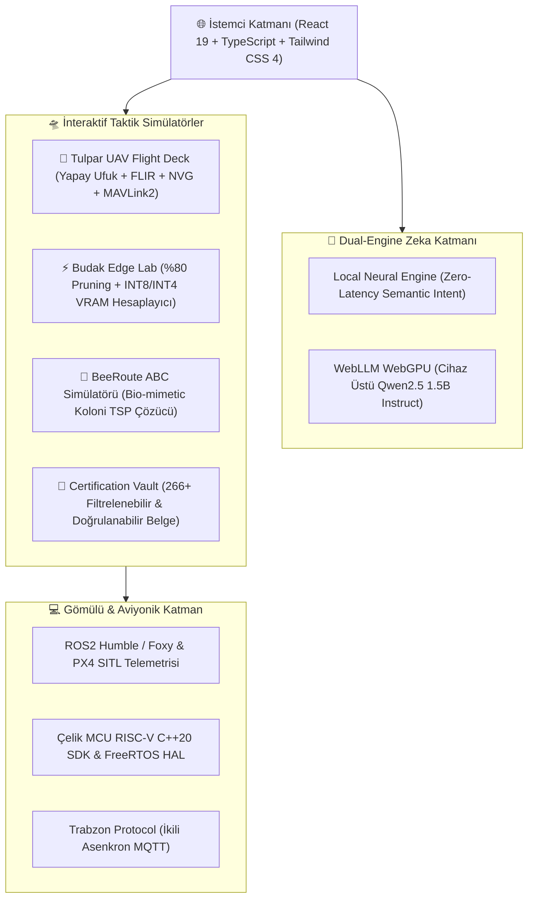

<div align="center">

# ⚡ BAHATTİN YUNUS ÇETİN
### **AI Developer · UAV Systems Architect · Embedded Systems Engineer**
**Founder @ Arat Labs · Tulpar Aero-Dynamics · Arkıl Games · MERL · Budak · Anka Silicon Dynamics**

[](https://bahattinyunus.github.io/)
[](https://www.linkedin.com/in/bahattinyunus/)
[](https://github.com/bahattinyunus)
[](https://medium.com/@bahattinyunus)
[](https://www.typescriptlang.org/)
[](https://bahattinyunus.github.io/)

<br/>

```text
  ██████╗ ███████╗████████╗██████╗  ██████╗ ███████╗ ██████╗ ██╗      ██╗███████╗
 ██╔════╝ ██╔════╝╚══██╔══╝██╔══██╗██╔═══██╗██╔════╝██╔═══██╗██║      ██║██╔════╝
 ██║  ███╗█████╗     ██║   ██████╔╝██║   ██║███████╗██║   ██║██║      ██║███████╗
 ██║   ██║██╔══╝     ██║   ██╔══██╗██║   ██║╚════██║██║   ██║██║      ██║╚════██║
 ╚██████╔╝███████╗   ██║   ██████╔╝╚██████╔╝███████║╚██████╔╝███████╗██║███████║
  ╚═════╝ ╚══════╝   ╚═╝   ╚═════╝  ╚═════╝ ╚══════╝ ╚═════╝ ╚══════╝╚═╝╚══════╝
                            METAL YAKA // PROTOCOL v5.0
```

</div>

---

## 🌌 Genel Bakış (Overview)

Bu repo; **Otonom İHA/SİHA Sistemleri**, **Büyük Dil Modelleri (LLM/Knowledge Distillation)**, **Edge-AI Optimizasyonu (%80 Pruning)**, **Gömülü Sistemler (RTOS/RISC-V)** ve **Siber Savunma** disiplinlerinde geliştirilen yüksek teknolojili Ar-Ge projelerini, girişimleri, interaktif telemetri simülatörlerini ve akademik faaliyetleri sergileyen yeni nesil **Cyberpunk / Metal Yaka v5.0** portföy sistemidir.

🔗 **Canlı Sistem:** [https://bahattinyunus.github.io/](https://bahattinyunus.github.io/)

---

## 🏗️ Sistem Mimarisi (Architecture Flow)



---

## 🛸 Temel İnteraktif Modüller & Özellikler

### 1. 🛫 Tulpar UAV Flight Deck (`TulparFlightDeck.tsx`)
- **Fiziksel Uçuş Telemetrisi:** Gerçek zamanlı yapay ufuk (artificial horizon), pitch/roll dinamikleri, dijital airspeed ve barometrik irtifa göstergeleri.
- **Sensör Görüntüleme Modları:** `CYBER_HUD`, `FLIR_THERMAL` (kızılötesi termal kamera modu) ve `NVG_GREEN` (gece görüş simülasyonu).
- **Hedef Kilitleme (Target Lock):** Dinamik hedef mesafe ve koordinat HUD retikülü ile sesli ikaz simülasyonu.
- **Manuel Manüvra Kontrolleri:** Taktik butonlarla burun kaldırma (pitch), yatış (roll) ve otomatik yatay düzleme.
- **Saha Protokolleri:** ROS2 Humble, MAVLink2 çift yönlü telemetri köprüsü ve gerçek zamanlı paket sayacı.

### 2. ⚡ Budak Edge-AI Pruning Lab (`BudakEdgeLab.tsx`)
- **%80 Model Budama (Pruning):** Yapılandırılmış ve yapılandırılmamış tensör budama motoru.
- **Donanım Seviyesinde Gizlilik:** FP16, INT8 ve INT4 nicemleme (Quantization) ile canlı VRAM tasarrufu ve gecikme (latency) hesaplayıcısı. Sıfır bulut sızıntısı.
- **Hazır Kod Dışa Aktarma:** Tek tıkla kopyalanabilir PyTorch / AutoGPTQ üretim budama betiği.
- **Hedef Donanım Karşılaştırması:** Otonom İHA Companion, NVIDIA Jetson Orin Nano, Raspberry Pi 5 ve Çelik MCU RISC-V donanım profilleri.

### 3. 📜 266+ Sertifika & Akreditasyon Kasası (`CertificationVault.tsx`)
- **Doğrulanmış Kayıtlar:** SHGM İHA-1 Pilotaj Lisansı, TEI Havacılık Motorları Okulu, TÜBİTAK/GSB KAMP+ Uzay (Radyo Astronomi), BGD KAMP+ Siber Savunma, TUA Astro Hackathon, BTK Akademi ve Bilgeİş akreditasyonları için filtreli, anlık aramalı ve tek tıkla kopyalanabilir dijital kasa.

### 4. 🧠 Vanguard AI Taktik Asistanı (`VanguardAI.tsx`)
- **Dual-Engine Mimari:** Hem sıfır gecikmeli yerel deterministik kural motoru hem de WebGPU üzerinden tarayıcıda doğrudan koşan Hugging Face Qwen2.5 1.5B Instruct yapay zekâsı.
- **Saha Bilgi Tabanı:** ASELSAN Gölbaşı saha gezisi, Fransa Gençlik Değişimi, TUA CubeSat görevi, ODTÜ/Hacettepe eğitimi ve 231+ repo hakkında anlık cevaplar.

### 5. ⌨️ Taktik Sistem Terminali (`CommandTerminal.tsx`)
- **Klavye Kısayolu:** <kbd>Ctrl</kbd> + <kbd>K</kbd> veya <kbd>`</kbd> (Backtick) tuşuyla anında açılır.
- **Desteklenen Komutlar:**
  - `whoami`: Operatör kimlik kartı ve akademik matris.
  - `cv` / `resume`: Doğrulanmış resmi CV dosyasını (PDF) anında açar.
  - `tulpar`: Tulpar Flight Deck simülatörüne doğrudan atlar.
  - `budak`: Budak %80 model budama laboratuvarına gider.
  - `certs` / `vault`: 266+ sertifika kasasını açar.
  - `audio` / `sound`: Prosedürel Web Audio API cyber synth atmosferini açar/kapatır.
  - `locks`: Yüksek güvenlikli kasayı (Secure Mode) aktifleştirir.
  - `stats`: 231+ repo, 1500+ yıldız ve GitHub/LinkedIn istatistiklerini listeler.
  - `ping`: Uç birim düğüm gecikme sürelerini test eder.

---

## 🏢 Kurucu Girişimler & Ar-Ge Ekosistemi

| Girişim | Rol | Odak Alanı & Açıklama |
| :--- | :--- | :--- |
| **Arat Labs** | Kurucu & Baş Yazılım Mühendisi | Next-Gen AI Architectures, asimetrik sistem mühendisliği ve derin teknoloji Ar-Ge'si. |
| **Tulpar Aero-Dynamics** | Kurucu & Baş Teknoloji Mimarı | UE5 fizik tabanlı uçuş simülasyonları, İHA/SİHA ve eVTOL otonom uçuş algoritmaları. |
| **Arkıl Games** | Kurucu & Yaratıcı Direktör | Türk mitolojisi tabanlı evren tasarımı ve prosedürel oyun motoru mimarisi. |
| **MERL (Meta-Engineering Research Lab)** | Baş Araştırmacı & Kurucu | İnsan müdahalesiz otonom kod fabrikaları & stokastik zeka modelleri. |
| **Budak \| Edge-AI Optimization** | Kurucu & Baş Araştırma Mühendisi | %80 Model budama & INT8/INT4 donanım seviyesinde veri gizliliği kalkanı. |
| **Anka Silicon Dynamics** | Kurucu & Baş Sistem Mimarı | Knowledge Distillation ile donanım bağımsız zeka & milli NPU/FPGA simülasyonları. |

---

## 🎓 Akademik Matris & Akreditasyonlar

- 🏫 **Orta Doğu Teknik Üniversitesi (ODTÜ)** — Bilgisayar ve Öğretim Teknolojileri Eğitimi (BÖTE / CEIT, 2026 – 2032)
- 🏫 **Hacettepe Üniversitesi** — Mühendislik & Alternatif Enerji Teknolojileri (2026 – 2030)
- 🏫 **Karadeniz Teknik Üniversitesi (KTÜ)** — Yazılım Mühendisliği (2024 – 2026)
- 🏫 **Recep Tayyip Erdoğan Üniversitesi (RTEÜ)** — Bilişim ve Teknoloji (2024 – 2026)
- 🏫 **İstanbul Üniversitesi** — Yönetim Bilişim Sistemleri (AUZEF, 2025 – 2029)
- 🎖️ **SHGM:** İHA-1 Sportif/Amatör Pilotaj Lisansı
- 🎖️ **TEI:** 6. Dönem Havacılık Motorları Okulu (Gaz Türbinli Motorlar)
- 🎖️ **TÜBİTAK & GSB:** KAMP+ Havacılık ve Uzay Kampı (Bursa - FezaArsivi)
- 🎖️ **BGD & GSB:** KAMP+ Siber Güvenlik Kampı (SOC, Pentest & Adli Bilişim)
- 🎖️ **Türkiye Uzay Ajansı (TUA):** Astro Hackathon (15 CubeSat / Derin Uzay Görevi)
- 🎖️ **GSB & TMV:** Türkiye–Fransa Gençlik Değişimi Programı (66.500+ aday arasından seçilen 20 gençten biri)

---

## 💻 Amiral Gemisi Açık Kaynak Repolar

- **[BeeRoute](https://github.com/bahattinyunus/BeeRoute):** Bio-mimetic Yapay Arı Kolonisi (ABC) NP-Hard rota optimizasyonu ($O(G \cdot S \cdot n^2)$).
- **[Tulpar-Aero-Simulator](https://github.com/bahattinyunus/tulpar-aero-dynamics):** UE5 & ROS2 telemetri ve aerodinamik uçuş simülatörü.
- **[Budak-Edge-Pruner](https://github.com/bahattinyunus/budak-edge-ai):** PyTorch/ONNX %80 model budama ve INT8/INT4 cihaz üstü gizlilik motoru.
- **[Anka-Distill-Core](https://github.com/bahattinyunus/anka-silicon-dynamics):** 70B teacher modellerini 7B/8B student modellerine aktaran Knowledge Distillation mimarisi.
- **[FezaArsivi](https://github.com/bahattinyunus/FezaArsivi):** TÜBİTAK/TUA destekli radyo astronomi ve CubeSat telemetri merkezi.
- **[Aura-Hockey-AR](https://github.com/bahattinyunus/Aura-Hockey-AR):** MediaPipe & Three.js 3D WebGL Ankara AI Hackathon AR projesi.
- **[Celik-MCU-RISCV-SDK](https://github.com/bahattinyunus/Celik-MCU-SDK):** İlk yerli RISC-V çipi Çelik MCU için gömülü C++ SDK ve RTOS HAL katmanı.
- **[Trabzon-Protocol-MQTT](https://github.com/bahattinyunus/Trabzon-Protocol):** Denizcilik ve İHA telemetrisi için hafif asenkron ikili haberleşme protokolü.
- **[Arkil-Mythos-Engine](https://github.com/bahattinyunus/arkil-games):** Türk mitolojisi tabanlı prosedürel evren ve UE5 C++ davranış ağaçları motoru.
- **[Math2Code-Guide](https://github.com/bahattinyunus/Math2Code-A-Practical-Guide-for-Developers):** Matematiksel modelleri yüksek başarımlı koda dönüştürme rehberi (200+ Yıldız).

---

## 🛠️ Teknoloji Yığını (Tech Stack)

| Kategori | Teknolojiler |
| :--- | :--- |
| **Frontend & UI** | React 19, TypeScript, Tailwind CSS 4, Shadcn/UI, Lucide React, Framer Motion |
| **PWA & Mobil** | Web App Manifest, Standalone Mode, Touch-Optimized, Offline Caching |
| **Ses & Akustik** | Web Audio API Procedural Synth (Sıfır Dış Ses Dosyası Bağımlılığı) |
| **Grafik & 3D** | Three.js, WebGL, Canvas API, Unreal Engine 5 |
| **Yapay Zeka & ML** | PyTorch, TensorFlow, Unsloth, vLLM, QLoRA, TFLite, WebLLM (Qwen2.5), ONNX Runtime |
| **Robotik & Havacılık** | ROS2 (Humble/Foxy), PX4 SITL, Gazebo, MAVLink2, Microstrip RF |
| **Gömülü & Diller** | C++17/20, C, Python, Rust, Go, RISC-V Assembly, FreeRTOS |
| **Siber Güvenlik** | Zero Trust, Pwntools, Ghidra, Scapy, AES-256-GCM, Linux Cgroups |

---

## 🏃‍♂️ Yerel Kurulum & Çalıştırma

```bash
# 1. Depoyu klonlayın
git clone https://github.com/bahattinyunus/bahattinyunus.github.io.git
cd bahattinyunus.github.io

# 2. Bağımlılıkları yükleyin
npm install

# 3. Geliştirme sunucusunu başlatın
npm run dev

# 4. Üretim sürümü için derleyin
npm run build
```

---

## 📬 İletişim & Ağ

- **E-Posta:** [bahattinyunuscetin1@gmail.com](mailto:bahattinyunuscetin1@gmail.com)
- **LinkedIn:** [linkedin.com/in/bahattinyunus](https://www.linkedin.com/in/bahattinyunus/) (12.600+ Bağlantı & Takipçi)
- **GitHub:** [github.com/bahattinyunus](https://github.com/bahattinyunus) (231+ Kamu Reposu)
- **Medium:** [medium.com/@bahattinyunus](https://medium.com/@bahattinyunus)

---

<div align="center">
  <sub>Geliştirici: <strong>Bahattin Yunus ÇETİN</strong> · Ankara, Türkiye · MIT Lisansı</sub>
</div>
